# ROLE & OBJECTIVE
You are a Principal Data Warehouse Architect, Formula 1 Race Strategy Engineer, and Full-Stack Machine Learning Developer. Your objective is to build an end-to-end Data Warehouse and Decision-Support Application titled:
"Data-Driven Formula 1 Race Strategy Recommendation Using Tyre Degradation Modelling and Weather-Aware Machine Learning"

The system ingests 9 historical Formula 1 datasets (2023-2025 seasons) from the `Data_Mining_F1_porject` directory, processes them through a Medallion Data Warehouse Architecture (Bronze -> Silver -> Race State Replay -> Gold), and powers an interactive "Pit-Wall Strategist Computer" application that recommends the Top 3 optimal race strategies (evaluating tyre degradation, weather, track temperature, pit loss, and risk vs. reward of BOX NOW vs. STAY OUT).

---

# STRICT SYSTEM CONSTRAINTS (NON-NEGOTIABLE)
1. NO EMOJIS: Never use emojis anywhere in SQL scripts, Python/JavaScript code, comments, UI components, terminal logs, or Markdown reports. Use strictly text badges (`[S]`, `[M]`, `[H]`, `[I]`, `[W]`, `[GREEN]`, `[SC]`, `[VSC]`, `[RED]`) or geometric SVG icons.
2. PURE SQL IN BRONZE & SILVER: Phase 1 (Bronze Layer) and Phase 2 (Silver Layer) must be implemented using ONLY `.sql` scripts (DDL, DML, CTEs, Window Functions, Views). Do NOT use Python, Pandas, or external transformation scripts in Phase 1 or Phase 2.
3. MANDATORY DATA EVENTS REPORT PER PHASE: At the completion of every phase, generate a formal Markdown Audit Report (`01_BRONZE_REPORT.md`, `02_SILVER_REPORT.md`, `03_RACE_STATE_REPORT.md`, `04_GOLD_REPORT.md`) backed by SQL audit queries that log every single event, row count, null count, anomaly filtered, imputation, and transformation that occurred on the data during that phase.
4. TEAM TASK ALLOCATION: Every phase, code module, SQL script, and report section must explicitly divide responsibilities across the four team members:
   - Mohamed
   - Yousef
   - Mahmud
   - Moaz
5. UI VISUAL THEME & BRANDING: All visual interfaces (Phase 3 Race State Replay and Phase 4 Pit-Wall Strategist App) must strictly use a Matte Black (`#0B0C10`, `#12151E`) and Electric Pit-Wall Blue (`#00F0FF`, `#0066FF`, `#0033AA`) theme. Integrate the official Formula 1 logo in the global header and official F1 Constructor logos paired with their exact `team_colour` hex codes from the warehouse.

---

# SYSTEM ARCHITECTURE DIAGRAM (MERMAID)

```mermaid
flowchart TB
    classDef source fill:#12151E,stroke:#00F0FF,stroke-width:2px,color:#FFFFFF
    classDef bronze fill:#1A1410,stroke:#CD7F32,stroke-width:2px,color:#FFFFFF
    classDef silver fill:#181C24,stroke:#C0C0C0,stroke-width:2px,color:#FFFFFF
    classDef replay fill:#0B0C10,stroke:#0066FF,stroke-width:2px,color:#00F0FF
    classDef gold fill:#1F1A0E,stroke:#FFD700,stroke-width:2px,color:#FFFFFF
    classDef app fill:#0B0C10,stroke:#00F0FF,stroke-width:3px,color:#00F0FF
    classDef report fill:#141824,stroke:#0066FF,stroke-dasharray: 5 5,color:#FFFFFF

    subgraph SRC["SOURCE DATA: Data_Mining_F1_porject (9 CSVs | 2023-2025)"]
        S1["Race_Laps.csv & Stint_Summary.csv"]:::source
        S2["Pit_Stops.csv & Race_Control.csv"]:::source
        S3["Weather.csv & Races.csv"]:::source
        S4["Drivers.csv, Constructors.csv & Race_Results.csv"]:::source
    end

    subgraph P1["PHASE 1: BRONZE LAYER (Pure .SQL Only - Raw VARCHAR Staging)"]
        B1["Mohamed: bronze.raw_race_laps & bronze.raw_stint_summary"]:::bronze
        B2["Yousef: bronze.raw_pit_stops & bronze.raw_race_control"]:::bronze
        B3["Mahmud: bronze.raw_weather & bronze.raw_races"]:::bronze
        B4["Moaz: bronze.raw_drivers, raw_constructors, raw_race_results"]:::bronze
        R1["Report: 01_BRONZE_REPORT.md (Row Counts, Nulls, Duplicates)"]:::report
    end

    subgraph P2["PHASE 2: SILVER LAYER (Pure .SQL Only - Cleaned Star Schema)"]
        SV1["Mohamed: silver.fact_race_laps (107% Outlier Filter, Fuel Correction, Speed Imputation)"]:::silver
        SV2["Yousef: silver.fact_pit_stops & silver.fact_race_control (Net Pit Loss & Flag Parsing)"]:::silver
        SV3["Mahmud: silver.dim_races & silver.fact_weather (Pirelli C1-C6 Map & Time Alignment)"]:::silver
        SV4["Moaz: silver.dim_drivers, dim_constructors, fact_stint_summary, fact_race_results"]:::silver
        R2["Report: 02_SILVER_REPORT.md (Outliers Removed, Casts, Deduplications)"]:::report
    end

    subgraph P3["PHASE 3: RACE STATE TIMELINE REPLAY (Lights Out to Chequered Flag)"]
        RP1["Mohamed: silver.vw_race_state_timeline (Lap 1 to Final Lap Position & Gap Engine)"]:::replay
        RP2["Yousef: Live Pit Window Markers & FIA Race Control Flag Ticker"]:::replay
        RP3["Mahmud: Dynamic Track Temp, Wind & Rainfall Progression Sync"]:::replay
        RP4["Moaz: Black & Blue Replay Dashboard (F1 & Team Logos, Stint Gantt, Scrubber)"]:::replay
        R3["Report: 03_RACE_STATE_REPORT.md (Lap State Transitions & Incident Logs)"]:::report
    end

    subgraph P4["PHASE 4: GOLD LAYER & PIT-WALL STRATEGIST APP (Top 3 Strategy Engine)"]
        G1["Mohamed: gold.mart_tyre_degradation + XGBoost/LightGBM Pace & Deg Models"]:::gold
        G2["Yousef: gold.mart_pit_windows + Random Forest Pit Classifier & SC Risk Engine"]:::gold
        G3["Mahmud: gold.mart_circuit_clusters + K-Means & Monte Carlo / DP Simulator"]:::gold
        G4["Moaz: Pit-Wall Strategist App (Black/Blue UI, Top 3 Strategies, BOX vs STAY OUT Gauge)"]:::app
        R4["Report: 04_GOLD_REPORT.md (MAE/RMSE/F1/AUC & Simulated Time Saved)"]:::report
    end

    S1 --> B1
    S2 --> B2
    S3 --> B3
    S4 --> B4
    B1 & B2 & B3 & B4 --> R1

    B1 --> SV1
    B2 --> SV2
    B3 --> SV3
    B4 --> SV4
    SV1 & SV2 & SV3 & SV4 --> R2

    SV1 --> RP1
    SV2 --> RP2
    SV3 --> RP3
    RP1 & RP2 & RP3 --> RP4 --> R3

    SV1 & SV4 --> G1
    SV2 --> G2
    SV3 --> G3
    G1 & G2 & G3 --> G4 --> R4
```



---

# PROJECT DIRECTORY STRUCTURE
Create and maintain the following exact repository layout:

```text
F1_PitWall_DataWarehouse/
|-- data/
|   `-- raw/                                 # Symlink or copy of Data_Mining_F1_porject CSVs
|       |-- Constructors.csv
|       |-- Drivers.csv
|       |-- Pit_Stops.csv
|       |-- Race_Control.csv
|       |-- Race_Laps.csv
|       |-- Race_Results.csv
|       |-- Races.csv
|       |-- Stint_Summary.csv
|       `-- Weather.csv
|-- sql/
|   |-- 01_bronze/                           # STRICTLY PURE .SQL
|   |   |-- 01_mohamed_bronze_laps_stints.sql
|   |   |-- 02_yousef_bronze_pits_control.sql
|   |   |-- 03_mahmud_bronze_weather_races.sql
|   |   `-- 04_moaz_bronze_entities_and_audit.sql
|   |-- 02_silver/                           # STRICTLY PURE .SQL
|   |   |-- 01_mohamed_silver_fact_laps.sql
|   |   |-- 02_yousef_silver_pits_and_flags.sql
|   |   |-- 03_mahmud_silver_weather_and_circuits.sql
|   |   `-- 04_moaz_silver_dimensions_and_audit.sql
|   |-- 03_race_state/
|   |   `-- 01_race_state_timeline_views.sql
|   `-- 04_gold/
|       |-- 01_mohamed_gold_degradation_marts.sql
|       |-- 02_yousef_gold_pit_and_sc_marts.sql
|       |-- 03_mahmud_gold_circuit_cluster_marts.sql
|       `-- 04_moaz_gold_strategy_comparison_marts.sql
|-- ml_engine/
|   |-- mohamed_pace_degradation_xgb.py      # XGBoost/LightGBM & Mixed-Effects Degradation
|   |-- yousef_pit_classifier_rf.py          # Random Forest Pit Window, Compound & SC Risk
|   `-- mahmud_kmeans_and_monte_carlo.py     # K-Means Clustering & Dynamic Programming Top-3 Sim
|-- app/
|   |-- assets/
|   |   |-- f1_logo.svg
|   |   `-- teams/                           # Official Constructor SVGs/PNGs
|   |-- styles/
|   |   `-- pitwall_black_blue.css           # Matte Black (#0B0C10) & Electric Blue (#00F0FF)
|   |-- pages/
|   |   |-- 01_race_state_replay.py          # Phase 3: Lights Out to Chequered Flag Replay
|   |   `-- 02_pitwall_strategist.py         # Phase 4: Top 3 Strategy Recommender & Risk Gauge
|   `-- main.py
`-- reports/
    |-- 01_BRONZE_REPORT.md
    |-- 02_SILVER_REPORT.md
    |-- 03_RACE_STATE_REPORT.md
    `-- 04_GOLD_REPORT.md
```

---

# SOURCE DATASET SCHEMAS (GROUND TRUTH CONTEXT)
1. `Races.csv`: `session_key, session_type, session_name, date_start, date_end, meeting_key, circuit_key, circuit_short_name, country_key, country_code, country_name, location, gmt_offset, year, is_cancelled, meeting_name, meeting_official_name, circuit_type, round, C_hard, C_medium, C_soft`
2. `Drivers.csv`: `year, driver_number, full_name, name_acronym, broadcast_name, team_name, team_colour, races_entered, first_round, last_round, final_points, final_position`
3. `Constructors.csv`: `year, team_name, team_colour, drivers, races, final_points, final_position`
4. `Race_Results.csv`: `year, round, meeting_key, meeting_name, session_key, session_name, circuit_short_name, country_name, position, driver_number, number_of_laps, points, dnf, dns, dsq, duration, gap_to_leader, name_acronym, full_name, team_name`
5. `Stint_Summary.csv`: `year, round, meeting_key, meeting_name, session_key, session_name, circuit_short_name, country_name, driver_number, name_acronym, team_name, stint_number, compound, compound_code, lap_start, lap_end, laps, tyre_age_at_start, tyre_is_new, clean_laps, avg_clean_lap_s, best_lap_s, deg_slope_raw_s_per_lap, deg_slope_fuel_corrected_s_per_lap`
6. `Pit_Stops.csv`: `year, round, meeting_key, meeting_name, session_key, session_name, circuit_short_name, country_name, date, pit_duration, driver_number, lap_number, lane_duration, stop_duration, name_acronym, team_name`
7. `Weather.csv`: `year, round, meeting_key, meeting_name, session_key, session_name, circuit_short_name, country_name, date, track_temperature, wind_speed, rainfall, humidity, air_temperature, pressure, wind_direction`
8. `Race_Control.csv`: `year, round, meeting_key, meeting_name, session_key, session_name, circuit_short_name, country_name, date, driver_number, lap_number, category, flag, scope, sector, qualifying_phase, message`
9. `Race_Laps.csv`: `year, round, meeting_key, meeting_name, session_key, session_name, circuit_short_name, country_name, date_start, driver_number, lap_number, lap_duration, duration_sector_1, duration_sector_2, duration_sector_3, i1_speed, i2_speed, st_speed, is_pit_out_lap, date_end, name_acronym, full_name, team_name, stint_number, compound, tyre_age_at_start, stint_lap_start, stint_lap_end, compound_code, tyre_age_laps, tyre_is_new, pit_lane_duration_s, pit_stop_duration_s, is_pit_in_lap, safety_car_in_lap, vsc_in_lap, red_flag_in_lap, yellow_events_in_lap, yellow_flag_in_lap, race_condition, weather_air_temperature, weather_track_temperature, weather_humidity, weather_pressure, weather_wind_speed, weather_wind_direction, weather_rainfall, rainfall_share_of_lap, position_end_of_lap, lap_is_clean, fuel_corrected_lap_time, deg_vs_stint_best_s, stint_deg_slope_s_per_lap, is_first_lap`

---

# EXECUTION PHASES & TASK LISTS

Execute the project sequentially through the 4 phases below. Complete all tasks and generate the required report for each phase before moving to the next.

## PHASE 1: BRONZE MEDALLION LAYER (RAW INGESTION & AUDIT - PURE .SQL ONLY)
Constraint: Use ONLY `.sql` scripts. Load all columns as raw text/varchar to prevent ingestion truncation, appending `_ingested_at` and `_source_file`.

### Task List:
* **Mohamed (Core Lap Telemetry & Stint Staging):**
  - [ ] Task 1.1: Write SQL DDL to create schema `bronze` and tables `bronze.raw_race_laps` and `bronze.raw_stint_summary`.
  - [ ] Task 1.2: Write SQL bulk load (`COPY` / `BULK INSERT`) statements to ingest `Race_Laps.csv` and `Stint_Summary.csv`.
  - [ ] Task 1.3: Write SQL diagnostic queries counting total rows, distinct `session_key` values per year (2023, 2024, 2025), and NULL frequencies in `lap_duration`, `i1_speed`, `i2_speed`, `st_speed`, `compound_code`, and `deg_vs_stint_best_s`.
* **Yousef (Pit Stops & FIA Race Control Staging):**
  - [ ] Task 1.4: Write SQL DDL and bulk load scripts for `bronze.raw_pit_stops` (`Pit_Stops.csv`) and `bronze.raw_race_control` (`Race_Control.csv`).
  - [ ] Task 1.5: Write SQL diagnostic queries profiling missing `stop_duration` vs `lane_duration` in `raw_pit_stops` and distribution of `category`, `flag`, and `scope` values in `raw_race_control`.
* **Mahmud (Weather Telemetry & Circuit Metadata Staging):**
  - [ ] Task 1.6: Write SQL DDL and bulk load scripts for `bronze.raw_weather` (`Weather.csv`) and `bronze.raw_races` (`Races.csv`).
  - [ ] Task 1.7: Write SQL queries identifying non-Race sessions in `raw_weather` (such as `Practice 1`), mixed timestamp formats in `raw_races` (`date_start` vs `date_end`), and missing Pirelli allocations (`C_hard`, `C_medium`, `C_soft`).
* **Moaz (Competitor Entities, Results & Bronze Master Report):**
  - [ ] Task 1.8: Write SQL DDL and bulk load scripts for `bronze.raw_drivers` (`Drivers.csv`), `bronze.raw_constructors` (`Constructors.csv`), and `bronze.raw_race_results` (`Race_Results.csv`).
  - [ ] Task 1.9: Write SQL queries detecting duplicate `(year, driver_number)` rows in `raw_drivers` caused by mid-season team changes or case differences in `team_colour` (e.g., `3671C6` vs `3671c6`), and non-numeric `gap_to_leader` strings (e.g., `+1 LAP`) in `raw_race_results`.
  - [ ] Task 1.10: Create `bronze.vw_ingestion_audit_summary` and generate `reports/01_BRONZE_REPORT.md` documenting every raw table's row count, column count, null count, duplicate count, and detected formatting anomalies.

---

## PHASE 2: SILVER MEDALLION LAYER (CLEANING, ANOMALY FILTERING & STAR SCHEMA - PURE .SQL ONLY)
Constraint: Use ONLY `.sql` scripts. Transform `bronze` tables into a strongly-typed, cleaned, and deduplicated Star Schema in the `silver` schema.

### Task List:
* **Mohamed (Lap Telemetry Cleaning, Fuel Correction & 107% Outlier SQL Engine):**
  - [ ] Task 2.1: Create `silver.fact_race_laps` with strict SQL data types (`INTEGER`, `DOUBLE PRECISION`, `BOOLEAN`, `TIMESTAMP`).
  - [ ] Task 2.2: Implement SQL Window Functions (`PERCENTILE_CONT(0.5) WITHIN GROUP (ORDER BY lap_duration) OVER (PARTITION BY session_key, driver_number)`) to compute each driver's median lap time per race.
  - [ ] Task 2.3: Create a validated boolean column `is_valid_strategy_lap` in SQL that sets `FALSE` for: opening laps (`is_first_lap = TRUE`), pit in/out laps (`is_pit_in_lap = TRUE` or `is_pit_out_lap = TRUE`), neutralized laps (`safety_car_in_lap = TRUE`, `vsc_in_lap = TRUE`, `red_flag_in_lap = TRUE`), and slow outlier laps (`lap_duration > 1.07 * driver_median_lap_s`).
  - [ ] Task 2.4: Impute missing speed traps (`i1_speed`, `i2_speed`, `st_speed`) using stint-level SQL window averages (`AVG(...) OVER (PARTITION BY session_key, driver_number, stint_number)`) and record imputations in `is_speed_imputed`.
* **Yousef (Pit Stop Normalization & Race Control Flag Extraction):**
  - [ ] Task 2.5: Create `silver.fact_pit_stops`, casting durations to `DOUBLE PRECISION`, filtering out red-flag stationary pit lane waits (`pit_duration > 60.0`), and calculating `circuit_avg_pit_loss_s` using SQL window functions.
  - [ ] Task 2.6: Create `silver.fact_race_control` and use SQL `CASE WHEN` pattern matching on `message`, `category`, and `flag` to extract structured boolean indicators (`is_sc_event`, `is_vsc_event`, `is_red_flag_event`, `is_drs_change`, `is_track_limits_deletion`, `is_steward_penalty`).
* **Mahmud (Weather Time-Series Alignment & Pirelli C1-C6 Circuit Mapping):**
  - [ ] Task 2.7: Create `silver.dim_races`, standardizing `date_start` and `date_end` to UTC timestamps and populating empty `C_hard`, `C_medium`, and `C_soft` columns with official Pirelli `C1`–`C5` circuit compound codes via a deterministic SQL `CASE` mapping table.
  - [ ] Task 2.8: Create `silver.fact_weather`, filtering to Race sessions and using SQL window functions to compute rolling temperature change rates (`track_temp_delta_prev_5min`) and rain onset flags.
* **Moaz (Entity Deduplication, Stint Validation & Silver Master Report):**
  - [ ] Task 2.9: Create `silver.dim_constructors` and `silver.dim_drivers`, normalizing `UPPER(TRIM(team_colour))`, resolving team rebrands (`Alfa Romeo` / `Kick Sauber`, `AlphaTauri` / `RB` / `Racing Bulls`), and deduplicating multi-row seasonal driver entries using `ROW_NUMBER() OVER (PARTITION BY year, driver_number ORDER BY races_entered DESC)`.
  - [ ] Task 2.10: Create `silver.fact_race_results` (splitting `gap_to_leader` into numeric `gap_seconds` and integer `laps_down`) and `silver.fact_stint_summary` (mapping `compound_code` from `silver.dim_races`).
  - [ ] Task 2.11: Create `silver.vw_transformation_audit_log` in SQL and generate `reports/02_SILVER_REPORT.md` detailing exact row counts before/after cleaning, number of laps removed by each filter (Lap 1, Pit In/Out, SC/VSC/Red, >107% outlier), number of speed trap imputations, and deduplicated entity counts.

---

## PHASE 3: RACE STATE TIMELINE REPLAY ("FROM LIGHTS OUT TO CHEQUERED FLAG")
Constraint: Build an interactive chronological race state visualizer on top of `silver` tables using the Matte Black & Electric Blue theme, F1/Team logos, and zero emojis.

### Task List:
* **Mohamed (Chronological State SQL Engine & Position/Gap Tracker):**
  - [ ] Task 3.1: Create SQL view `silver.vw_race_state_timeline` that reconstructs the exact state of every race from `lap_number = 1` (lights out) to the final lap (chequered flag), including driver position, cumulative elapsed time, interval to car ahead, gap to leader, current compound, tyre age, `fuel_corrected_lap_time`, and `deg_vs_stint_best_s`.
* **Yousef (Pit Window & FIA Race Control Timeline Synchronizer):**
  - [ ] Task 3.2: Build the event synchronization query and timeline component that overlays exact pit-in/pit-out events, pit lane time lost, compound changes, and live FIA Race Control messages (`GREEN`, `YELLOW`, `SC`, `VSC`, `RED`, `DRS`) at each lap step.
* **Mahmud (Environmental & Track Evolution Timeline):**
  - [ ] Task 3.3: Build the synchronized weather progression module that plots `weather_track_temperature`, `weather_air_temperature`, `weather_wind_speed`, and `weather_rainfall` from lap 1 to the end of the race, highlighting thermal degradation crossovers.
* **Moaz (Black & Blue Replay Interface & Phase 3 Report):**
  - [ ] Task 3.4: Build `app/pages/01_race_state_replay.py` in Matte Black (`#0B0C10`) and Electric Blue (`#00F0FF` / `#0066FF`) with the official F1 logo and Constructor logos/colors (`team_colour`), featuring a Lap Scrubber (Lap 1 to End), Position Trace Chart, Stint Strategy Gantt Chart, and Live Telemetry Timing Tower.
  - [ ] Task 3.5: Generate `reports/03_RACE_STATE_REPORT.md` documenting the state transition logic, lap-by-lap synchronization queries, and summary statistics of race state changes (lead changes, SC deployments, weather transitions, and stint counts).

---

## PHASE 4: GOLD MEDALLION LAYER & PIT-WALL STRATEGIST APPLICATION (TOP 3 STRATEGY RECOMMENDER)
Constraint: Build Gold SQL Marts, train/evaluate the CRISP-DM Machine Learning models (Train: 2023-2024, Test: 2025), and deploy the Black & Blue Pit-Wall Strategist Computer App.

### Task List:
* **Mohamed (Gold Tyre Degradation Marts & Pace/Degradation Regression Models):**
  - [ ] Task 4.1: Write SQL script `01_mohamed_gold_degradation_marts.sql` to create `gold.mart_tyre_degradation_curves` and `gold.mart_driver_pace_features`.
  - [ ] Task 4.2: Build `ml_engine/mohamed_pace_degradation_xgb.py` training XGBoost, LightGBM, and Mixed-Effects regression models on 2023-2024 clean laps (`is_valid_strategy_lap = TRUE`) to predict `fuel_corrected_lap_time` and `stint_deg_slope_s_per_lap` on the 2025 test set. Calculate and log MAE and RMSE.
* **Yousef (Gold Pit Window Marts, Pit/Compound Classifiers & Risk Engine):**
  - [ ] Task 4.3: Write SQL script `02_yousef_gold_pit_and_sc_marts.sql` to create `gold.mart_pit_stop_loss_benchmarks` (Green vs. SC/VSC pit time cost per circuit) and `gold.mart_safety_car_lap_probabilities`.
  - [ ] Task 4.4: Build `ml_engine/yousef_pit_classifier_rf.py` training Random Forest and Gradient Boosted Decision Trees to predict: (a) Binary pit call within 1-3 laps (`BOX_NOW` vs `STAY_OUT`), (b) Multi-class next tyre compound (`SOFT`, `MEDIUM`, `HARD`, `INTERMEDIATE`, `WET`), and (c) Lap-level Safety Car / VSC probability. Calculate F1-score and ROC-AUC on the 2025 test set.
* **Mahmud (Gold Circuit Clustering & Monte Carlo / Dynamic Programming Top-3 Simulator):**
  - [ ] Task 4.5: Write SQL script `03_mahmud_gold_circuit_cluster_marts.sql` to create `gold.mart_circuit_wear_profiles` and run K-Means clustering in `ml_engine/mahmud_kmeans_and_monte_carlo.py` to group circuits and drivers by tyre wear and thermal sensitivity.
  - [ ] Task 4.6: Implement the Monte Carlo & Dynamic Programming Strategy Engine that takes any live race state (Selected Team, Driver, Circuit, Current Lap, Current Compound, Tyre Age, Track Temp, Rainfall, Race Flag Status) and simulates remaining laps to rank the **Top 3 Optimal Strategies** with expected total race time, pit window lap(s), next compound(s), and a quantitative **Risk vs. Reward Score** (evaluating whether to take the risk to pit or stay out).
* **Moaz (Pit-Wall Strategist Computer App & Final Gold Report):**
  - [ ] Task 4.7: Write SQL script `04_moaz_gold_strategy_comparison_marts.sql` to create `gold.mart_historical_vs_simulated_strategies` comparing actual team decisions against model recommendations.
  - [ ] Task 4.8: Build `app/pages/02_pitwall_strategist.py` in the Matte Black (`#0B0C10`) and Electric Blue (`#00F0FF`) theme with official F1 and Constructor Team logos, featuring:
    1. Pit-Wall Control Header (Select Team, Driver, Grand Prix, Lap, Weather, Track Temp, Flag Status).
    2. Primary Tactical Call Banner (`BOX THIS LAP` vs `STAY OUT`) with a Risk vs. Reward Gauge and Tyre Crossover Lap chart.
    3. Top 3 Strategy Recommendation Cards (displaying Strategy 1, Strategy 2, and Strategy 3 with stint bars, compound badges `[S]/[M]/[H]`, expected race time delta, and undercut/SC risk ratings).
    4. Historical Backtesting Panel comparing the recommender's Top Strategy against the actual strategy executed by the team on race day.
  - [ ] Task 4.9: Generate `reports/04_GOLD_REPORT.md` documenting all Gold marts, K-Means cluster assignments, ML evaluation metrics (MAE, RMSE, F1, ROC-AUC on 2025 test data), and total simulated race time saved across the 2025 season compared to fixed-lap baselines and actual team decisions.

---

# EXECUTION INSTRUCTION
Begin immediately with **Phase 1 (Bronze Medallion Layer)**. Output the complete, runnable `.sql` files for Mohamed, Yousef, Mahmud, and Moaz, and then generate the complete `reports/01_BRONZE_REPORT.md` before proceeding to Phase 2.